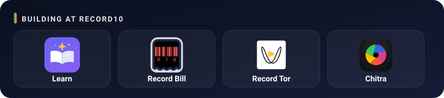
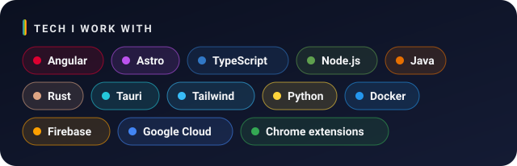

  

  
  
  &nbsp;&nbsp;
  
  
  
  
  

  
   
  <a href="https://learn.record10.com">Learn</a> · <a href="https://github.com/record10/record-bill-public">Record Bill</a> · <a href="https://github.com/record10/record-tor-public">Record Tor</a> · <a href="https://github.com/record10/chitra-public">Chitra</a> · <a href="https://record10.com">record10.com</a>

  

  

