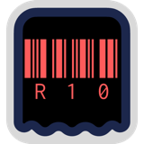

  

<b>ORGANISATIONS</b> 
&nbsp;

 

<b>ACHIEVEMENTS</b> 

 

<b>BUILDING AT RECORD10</b> 

 
<a href="https://learn.record10.com">Learn</a> · <a href="https://github.com/record10/record-bill-public">Record Bill</a> · <a href="https://github.com/record10/record-tor-public">Record Tor</a> · <a href="https://github.com/record10/chitra-public">Chitra</a>

  

<b>TECH</b> 
 

  

