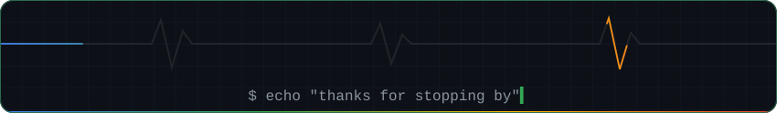

  

  
  
  &nbsp;&nbsp;<a href="https://record10.com"><b>record10.com</b></a> &nbsp;·&nbsp; <a href="https://learn.record10.com"><b>learn.record10.com</b></a>

&nbsp;<b>Building at Record10</b>

 

<a href="https://learn.record10.com">&nbsp;<b>Learn</b></a> &nbsp; <a href="https://github.com/record10/record-bill-public">&nbsp;<b>Record Bill</b></a> &nbsp; <a href="https://github.com/record10/record-tor-public">&nbsp;<b>Record Tor</b></a> &nbsp; <a href="https://github.com/record10/chitra-public">&nbsp;<b>Chitra</b></a>

&nbsp;<b>Tech I work with</b>

 

**Frontend** &nbsp; `Angular` `Astro` `Tailwind CSS` `Chrome extensions`

**Languages** &nbsp; `TypeScript` `Java` `Rust` `Python`

**Backend &amp; cloud** &nbsp; `Node.js` `Firebase` `Google Cloud` `Docker`

**Desktop &amp; mobile** &nbsp; `Tauri`

  

&nbsp;<b>Achievements</b> &nbsp;      

 
<table>
<tr><td width="48" align="center"></td><td><b>Pull Shark ×4</b> Pull requests merged, four tiers up.</td></tr>
<tr><td width="48" align="center"></td><td><b>Pair Extraordinaire ×3</b> Co-authored commits on merged pull requests.</td></tr>
<tr><td width="48" align="center"></td><td><b>Quickdraw</b> Closed an issue or pull request within 5 minutes of opening it.</td></tr>
<tr><td width="48" align="center"></td><td><b>YOLO</b> Merged a pull request without a review.</td></tr>
<tr><td width="48" align="center"></td><td><b>Arctic Code Vault Contributor</b> Code preserved in the 2020 GitHub Archive Program (Arctic Code Vault).</td></tr>
</table>

  

